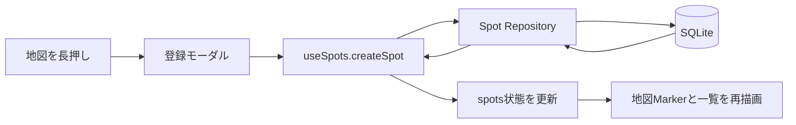

# Spot Map

訪れたい場所や記録しておきたい場所を地図上で管理するモバイルアプリです。

クロスプラットフォーム技術であるReact Native / Expoを採用し、位置情報、地図、写真ライブラリ、端末内ファイル、SQLiteといったスマートフォン固有の機能を扱っています。現在の実機検証対象はiOSで、iPhoneではApple Mapsを使用します。データは端末内に保存されるため、外部APIやAPIキーを必要としません。

## スクリーンショット

| 地図画面 | スポット一覧・検索 |
| --- | --- |
|  |  |

## 主な機能

- iPhoneのGPSを利用した現在地取得と地図表示
- 現在地マーカーの表示と、現在地へ戻る操作
- 位置情報の権限要求、取得失敗時の案内と再試行
- 地図の長押しによるスポット登録
- スポット名、メモ、緯度、経度、登録日時のSQLite保存
- 保存済みスポットの地図表示、詳細確認、編集、削除
- 写真ライブラリから選択した写真の追加、変更、削除
- スポット一覧の新着順表示と、名前・メモを対象にした検索
- 一覧で選択したスポットへの地図移動と詳細表示
- アプリ再起動後も保持されるスポット情報と写真

バックグラウンド位置追跡やクラウド同期は実装していません。地図表示にはreact-native-mapsを利用し、独自に契約する地図APIやAPIキーは必要ありません。

## 技術スタック

| 分類 | 技術 | 用途 |
| --- | --- | --- |
| UI | React 19 / React Native 0.88 | モバイルUI、状態に応じた画面更新 |
| 開発基盤 | Expo SDK 58 / Expo Go | ネイティブ機能を含む開発・実機確認 |
| 言語 | TypeScript 6 | 型安全なコンポーネント、データモデル、DB操作 |
| ルーティング | Expo Router | ファイルベースルーティング |
| 地図 | react-native-maps | iOSのApple Maps表示、Marker、地図操作 |
| 位置情報 | expo-location | 権限要求と現在地取得 |
| データベース | expo-sqlite | スポット情報と写真URIの端末内永続化 |
| 写真選択 | expo-image-picker | 写真ライブラリの権限要求と画像選択 |
| ファイル保存 | expo-file-system | 選択画像のアプリ永続保存領域へのコピー |
| リスト | React Native FlatList | スポット一覧の効率的な描画 |

## アーキテクチャ

UI、状態管理、永続化処理を分離し、画面コンポーネントがSQLiteやファイルシステムを直接操作しない構成にしています。スポットの状態は地図画面で呼び出す `useSpots()` に集約し、地図と一覧で同じデータを共有します。

```text
src/
├─ app/
│  ├─ _layout.tsx                  # Expo Routerのルートレイアウト
│  └─ index.tsx                    # 地図画面のエントリーポイント
├─ components/
│  ├─ location-map.tsx             # 地図と各機能の連携
│  ├─ location-state-view.tsx      # 位置情報の取得中・エラー表示
│  ├─ spot-form-modal.tsx          # スポット登録UI
│  ├─ spot-detail-modal.tsx        # 詳細、写真、削除操作
│  ├─ spot-edit-modal.tsx          # 編集UI
│  └─ spot-list-modal.tsx          # 一覧、検索、選択UI
├─ hooks/
│  ├─ use-current-location.ts      # 位置情報の状態管理
│  └─ use-spots.ts                 # スポットCRUDと画面状態の同期
├─ repositories/
│  └─ spot-repository.ts           # パラメータバインドによるSQL操作
├─ database/
│  └─ database.ts                  # DB初期化、テーブル作成、マイグレーション
├─ services/
│  └─ spot-photo-storage.ts        # 写真選択と永続ファイル管理
└─ types/
   └─ spot.ts                      # Spot型と入力型
```

## 地図操作から画面更新までのデータフロー



1. 地図の長押し座標を登録モーダルへ渡します。
2. 入力された名前・メモと座標を `useSpots()` からRepositoryへ渡します。
3. Repositoryがプレースホルダーとパラメータバインドを使ってSQLiteへ保存します。
4. 保存済みの `Spot` をフックの状態へ反映し、再取得を待たずにMarkerと一覧を更新します。
5. 編集・削除・写真URIの更新も同じ状態管理経路を通り、地図と一覧の不整合を防ぎます。

一覧からスポットを選択した場合は、地図を該当座標までアニメーション移動し、移動完了後に詳細モーダルを表示します。

## 写真ファイルとSQLiteのURI管理

写真のバイナリデータはSQLiteへ格納せず、アプリのドキュメント領域にある `spot-photos` ディレクトリへコピーします。SQLiteの `photo_uri` 列には保存先URIのみを記録します。

```text
写真ライブラリ
  → expo-image-pickerで選択
  → expo-file-systemで永続保存領域へコピー
  → 保存先URIをSQLiteのphoto_uriへ更新
  → URIから詳細画面・一覧サムネイルを表示
```

写真を変更したときは新しいファイルとDB更新が成功した後に古いファイルの削除を試みます。DB更新に失敗した場合も、新しくコピーしたファイルの削除を試みます。写真のみの削除やスポット削除時にも関連ファイルを削除しますが、端末側のファイル削除に失敗した場合は孤立ファイルが残る可能性があります。

## SQLiteとマイグレーション

起動時に `career-spots.db` を開き、WALモードと外部キー制約を有効にします。`spots` テーブルが存在しない場合は次の項目を持つテーブルを作成します。

| 列 | 内容 |
| --- | --- |
| `id` | スポットID |
| `name` | スポット名 |
| `note` | メモ |
| `latitude` / `longitude` | 登録座標 |
| `created_at` | 登録日時 |
| `photo_uri` | 永続保存した写真のURI。未設定時はNULL |

既存データを保持したまま写真機能を追加できるよう、`PRAGMA table_info(spots)` で列構成を確認し、`photo_uri` が存在しない場合だけ `ALTER TABLE` で追加します。DBファイルやテーブルの再作成は行いません。

## iPhone実機で確認した動作

Windows 11上で開発し、iPhone 14のExpo Goで次の動作を確認しています。

- 位置情報の権限要求と現在地取得
- Apple Mapsの表示、現在地マーカー、現在地復帰
- 地図の長押しによるスポット登録
- SQLiteへの登録・読み込み・編集・削除
- アプリ再起動後のデータ永続化
- 写真ライブラリからの写真添付、表示、変更、削除
- スポット一覧の表示、名前・メモによる検索、一覧から地図への移動

React Nativeはクロスプラットフォーム技術ですが、上記はiOSでの確認結果です。Androidを含む端末やOSの組み合わせによる挙動は、継続して確認します。

## 開発環境と起動方法

### 前提環境

- Windows 11
- Node.js 22.13以降
- npm
- iPhoneとExpo Go
- LAN接続を利用する場合は、開発PCとiPhoneが同じネットワークに接続されていること

### セットアップ

```bash
npm install
npx expo start
```

通常はLAN接続で開発サーバーを起動します。開発PCとiPhoneを同じネットワークへ接続できない場合や、LAN内の通信が制限されている場合は、次のようにExpoのトンネル接続を利用できます。

```bash
npx expo start --tunnel
```

ターミナルに表示されたQRコードをiPhoneで読み取り、Expo Goで起動します。位置情報へのアクセスは現在地取得時に要求されます。写真ライブラリへのアクセスはアプリ起動時ではなく、スポット詳細から写真選択を開始したときに要求されます。

### 静的チェック

```bash
npx tsc --noEmit
npm run lint
npx expo-doctor
```

自動テストは未導入です。現在はTypeScript、ESLint、Expo Doctorによる静的な検証と、iPhone実機での操作確認を行っています。

## 設計上の工夫

- RepositoryにSQLを集約し、UIと永続化処理の責務を分離
- SQL値をパラメータバインドし、文字列連結によるクエリ生成を回避
- SQLiteの初期化処理をPromiseで共有し、同時初期化を防止
- 地図と一覧が単一のスポット状態を共有し、更新直後の表示を同期
- 写真本体とメタデータを分離し、DBサイズとファイルのライフサイクルを管理
- 既存データを壊さない追加型マイグレーション
- 権限拒否、GPS取得失敗、DB操作失敗、写真保存失敗を画面上で案内
